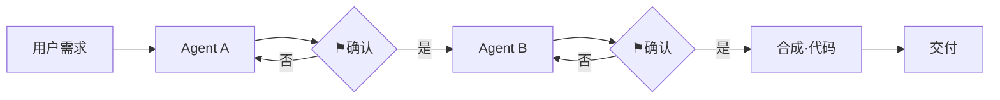
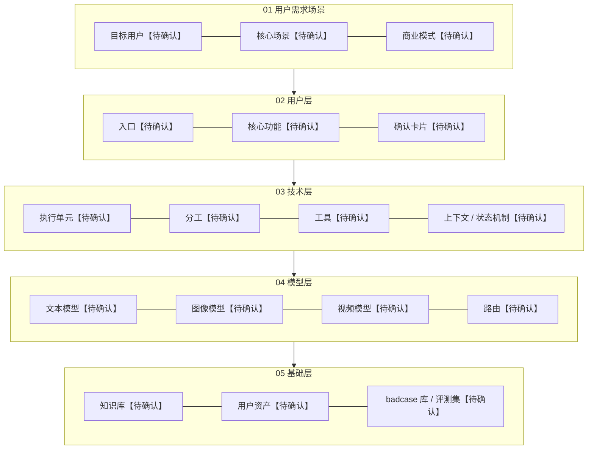

# 输出模板

> 用法：§1 是完整拆解的骨架，§2 是按需取用的表格。完整模式保留五层、体验证据和架构图；单功能／效果迭代只保留约定范围。市场、模型路由、Agent 深挖和量化评分按目的选用，不需要的部分直接删掉。
> 每个单元格或每条结论都标【事实】【推断】【待确认】中的一个。

---

## §1 拆解文档骨架

```markdown
# 拆解《产品名》：<一句话结论，例如"把一整个动画团队装进一个输入框">
- 拆解目的 / 模式 / 深度：<支持什么决定；完整 / 单功能 / 效果迭代；覆盖哪些层>
- 产品版本 / 日期 / 账号档位 / 环境限制：
- 任务、输入材料与验收标准：
- 取证范围：<亲测、用户实际记录、公开演示、官方文档分别列出>；取证日期：YYYY-MM-DD
- 体验状态与已覆盖范围：<已完成约定体验 / 部分体验 / 二手材料分析 / 等待补证；明确未测和影响>
- 证据标签：【事实】页面直接可见 ·【推断】有依据的推论 ·【待确认】查不到

## 00 体验与证据索引
体验记录、四类异常覆盖、截图／输出物索引：<真实文件或本文章节；未取得材料写待补>

## 01 用户需求场景
### 1.1 一句话定位　### 1.2 用户（B 端三个人 / C 端画像）
### 1.3 市场　### 1.4 竞争格局　### 1.5 差异化　### 1.6 商业模式　### 1.7 种子用户

## 02 用户层
### 2.1 功能模块　### 2.2 用户旅程图（正向五步 × 四行）　### 2.3 异常四条
### 2.4 正向 / 逆向流程　### 2.5 它替代了以前什么工作流　### 2.6 效果评价（按需量化）

## 03 技术层
### 3.1 技术流程图　### 3.2 人机分工表　### 3.3 确认点设计　### 3.4 光谱定位与依据
### 3.5 Agent 组成（适用时）　### 3.6 单个 Agent／可行实现示例（按需，分开标注）
### 3.7 全局上下文 / 状态管理 / 违规与 IP 防护　### 3.8 它没做好的地方

## 04 模型层
### 4.1 模型清单　### 4.2 路由逻辑　### 4.3 强模型 vs 聪明流程　### 4.4 成本估算　### 4.5 省钱手段

## 05 基础层
### 5.1 买得到 vs 买不到　### 5.2 数据内容与来源　### 5.3 数据飞轮　### 5.4 最厚的一层

## 汇总
### 分层架构图　### PM 结论（三件事 / 五个差距 / 如果我来做）　### （可选）竞品逐层对比

## 待核实清单
```

---

## §2 各层表格模板

### 00 体验与证据索引

使用[体验指南 §6–7](experience-guide.md)的记录表、异常覆盖表、证据索引与状态定义。可以在本报告合订，也可引用既有记录；不得把已索要截图等同于已取得证据。

| 材料 | 真实位置／章节 | 操作者与来源类型 | 已覆盖内容 | 未完成／限制 |
|---|---|---|---|---|
| 同任务体验记录 | | | | |
| 四类异常覆盖 | | | | |
| 截图／输出物索引 | | | | |

### 01 用户需求场景

**一句话定位**：一款给【】用的、在【】下、解决【】的【】。【推断】依据：官网标语「」+ 价格页收费对象 ___

| B 端三个人 | 是谁 | 为什么用 / 看什么指标 | 证据 |
|---|---|---|---|
| 用的人 | | | |
| 买单的人 | | | |
| 验收的人 | | | |

| 竞争格局 | 代表玩家 | 定位 / 用户为什么买单 | 和本产品的关系 |
|---|---|---|---|
| 工具 / 应用层 | | | 直接 / 间接竞品 |
| 平台层（渠道、分发） | | | 上下游 / 潜在竞争 |
| 模型厂商 | | | 供应商 / 潜在竞争 |

| 商业模式 | 内容 | 证据 |
|---|---|---|
| 收谁的钱 | | |
| 收费方式和档位 | 免费 / 档位 1 / 档位 2 / 企业版 | |
| 免费额度、付费点 | | |
| 种子用户来源 | | |

### 02 用户层

**用户旅程图**（⚑ 表示确认点）

| | ①入口 | ②输入 | ③过程 | ④输出 | ⑤交付 |
|---|---|---|---|---|---|
| 用户做什么 | | | | | |
| 产品给什么 | | | | | |
| 确认点 ⚑ | | | | | |
| 异常 / 卡点 | | | | | |

| 异常四条 | 已测／未测／不适用 | 操作与实际处理 | 评价或未测理由／影响 | 证据 |
|---|---|---|---|---|
| 信息给不全：会追问吗 | | | | |
| 失败：告诉你吗，钱退吗 | | | | |
| 中途改主意：要从头来吗 | | | | |
| 不满意：能只改一部分吗 | | | | |

**替代的工作流**：以前 ___（角色）用 ___（工具）花 ___（时间 / 钱）→ 现在用户只做 ___。


### 02 用户层 · 效果评价与可选评分

先写任务标准、实际结果、证据与影响；只有需要量化比较时才启用下表。以下是参考结构，使用前删改不适用维度，按本次任务确定唯一的一套权重、判据和阈值；不要同时套用 OiiOii 历史权重。三轮脚本与百分制均为扩展方法。

- 测试任务／输入／版本／日期／账号环境／样本数量：
- 评分规则版本／事先确定的判据／关键失败条件：
- 本次适用维度满分合计 100，满分值即权重；不适用项须事先调整规则，不临时删掉低分项。未测项留空或写未评分，不当成 0；覆盖不足时只交付分项观察，不给完整总分和评级。

| 能力层级 | 维度示例（按任务调整） | 可观察的打分判据 | 满分 | 得分 | 证据 ID／样本限制 |
|---|---|---|---:|---:|---|
| 端到端 | 成品质量 | 是否达到本次交付要求 | 20 | | |
| 端到端 | 一致性 | 已测步骤／样本中的一致程度 | 20 | | |
| 用户层 | 意图理解与引导 | 是否理解输入并补齐必要信息 | 15 | | |
| 用户层 | 修改与恢复 | 相关异常后能否继续任务 | 10 | | |
| 技术层 | 流程协作 | 上游修改能否正确影响后续结果 | 15 | | |
| 技术层 | 领域任务处理 | 结果是否符合明确的业务要求 | 10 | | |
| 模型与数据 | 模型选择体验 | 可见选项与结果是否支持任务选择 | 5 | | |
| 模型与数据 | 资产复用 | 已有资产能否在本次任务复用 | 5 | | |
| | **合计（覆盖充分才填写）** | | **100** | | |

**可选评级示例**：项目若采用，须在评分前确认；只描述本次样本，不能据总分证明长期稳定性或盖过关键失败项。

| 档 | 分数区间 | 本次样本的解释 |
|---|---|---|
| A | 90–100 | 基本达到预设目标 |
| B | 70–89 | 达成主要目标，仍需少量修改 |
| C | 60–69 | 存在明显缺口，部分内容可作草稿 |
| D | <60 | 未达到主要任务标准 |

不采用评级时只写分项或定性结论。生成 HTML 时原样带入实际采用的 `bands`；没有评级规则则不显示评级，缺测不补分。

### 03 技术层

**技术流程图**（mermaid 示例）


**人机分工表**

| 步骤 | AI 做 | 人做 | 固定程序做 | 确认点（类型） | 为什么要人 | 证据 |
|---|---|---|---|---|---|---|
| | | | | 动手前审方案 / 风险前停 / 事先给额度 / 用户调档 / 无 | 成本、主观、担责或其他真实约束 | |

**按功能判断架构**：Chatbot / Workflow / Agent / 多 Agent / 混合 / 尚未确认。不能仅凭计划、角色数或路径变化定类。

| 观察与证据 ID | 候选解释 | 其他可能解释 | 当前标签 | 如何核实 |
|---|---|---|---|---|
| | | | | |

**Agent 组成（适用时）**：页面角色与实际执行单元分开，内部读写字段没有证据时保持未知。

| Agent | 对应人类岗位 | 职责 | 读 / 写哪些上下文字段 | 人在哪介入（HITL） | 证据 |
|---|---|---|---|---|---|

结构：串行 / 并行 / 主子 Agent？依据：___

**单个 Agent 卡片**

| 项 | 内容 |
|---|---|
| 输入 | 收什么（用户输入、上游字段、表单回填） |
| 输出 | 交什么（字段、资产、动作、给下游的信号） |
| 任务 | 干哪件活，分几步，有哪些分支（明确 / 不明确 / 风险） |
| 工具 | 能调什么（生成类、检索类、表单 / 追问类、上下文 / 状态类、调度类） |
| 规则 | 守什么规矩（边界、禁止项、合规、格式） |
| 架构 | 可证实的架构或带依据的候选；未知不强选 ReAct / Planner-Executor |

自行设计的提示词、工具签名或实现结构另列“可行实现示例”，不写成原产品事实。

**它没做好的地方**

| 现象（截图 #） | 可能原因 | 解决方案（提示词 / 工具 / 状态机） | 证据 |
|---|---|---|---|

### 04 模型层

**模型清单**

| AI 步骤 | 模态 | 模型 / 档位 | 自研 / 外接 | 能否替换（换了会怎样） | 选择理由 | 证据 |
|---|---|---|---|---|---|---|

**路由逻辑**：自动路由 / 按风格或场景匹配 / 用户选 → ___；必须用强模型的环节：___；靠流程聪明就够的环节：___

路由与强弱模型判断只在本次任务相关时填写，未知保留；模型选择器不能独立证明选择原因。

**成本估算**（单任务，例如"一条 30 秒成片"）

| 步骤 | 模型 / 资源 | 调用次数 | 单价 | 小计 | 证据 |
|---|---|---|---|---|---|
| 文本规划 | LLM | n₁ | p₁ | n₁×p₁ | 【待确认】 |
| 图像生成 | 生图模型 | n₂ | p₂ | | |
| 视频生成 | 生视频模型（按秒） | 秒数 | p₃/秒 | | |
| 音频 | TTS / BGM | | | | |
| 其他 | 机器 / 沙箱 / 第三方接口 | | | | |
| **合计** | ×重试（抽卡）系数 k | | | **C = Σ × k** | 【推断】 |

| 收入侧 | 数值 | 证据 |
|---|---|---|
| 单任务扣多少积分 | | 扣费提示 / 积分规则 |
| 积分单价 = 档位价格 ÷ 档位积分 | | 价格页 |
| 按套餐换算的单任务收费估计 R（注明假设） | | |
| R − C 的差额／免费额度对应调用成本 | | 【推断】非实际利润；说明未含成本与摊销 |

查不到单价时：只写公式和假设区间，明确标【待确认】，不要给出看似精确的数字。

### 05 基础层

| 买得到（划掉） | 买不到（壁垒候选） | 越用越多吗 | 证据 |
|---|---|---|---|
| 模型 / 算力 / 通用工具 / 开源代码 | 自有数据 · 业务接口和权限 · 用户和组织上下文 · 攒下的方法（提示词 / skill / 工作流 / 知识库） | | |

| 数据 | 内容 | 来源 | 怎么用（训练 / 调提示词 / 案例） | 证据 |
|---|---|---|---|---|

**数据飞轮**：___（资产 / 会话 / 风格库 / skill）→ badcase 库 → 评测集 → 调 ___ → 效果 ↑ → 用户 ↑
**最厚的一层**：___ 层，因为 ___ → 这家公司要的 PM 需要懂 ___

### 汇总：分层架构图（框里写名词，每框带标签）



### 汇总：PM 结论

| 项 | 结论 |
|---|---|
| 体验设计 | |
| 能力边界（它不做什么） | |
| 信任设计（透出过程、确认点、退款） | |

| Demo → 完整产品的五个差距 | 它怎么补的 | 证据 |
|---|---|---|
| 给谁用 | | |
| 出了错怎么办 | | |
| 稳不稳 | | |
| 账算不算得过来 | | |
| 凭什么选你 | | |

**如果我来做**：改 ___ → 因为 ___ → 用 ___ 指标或实验验证。

### （可选）竞品逐层对比

| 层 | 本产品 | 竞品 A | 竞品 B | 差异的根源（回到定位） |
|---|---|---|---|---|
| 01 定位 | | | | |
| 02 交互形态 | 对话 / 画布 / 模板 | | | |
| 03 架构 | | | | |
| 04 模型与收费 | | | | |
| 05 壁垒 | | | | |

### 待核实清单

| # | 待确认事项 | 当前候选解释及依据 | 对结论的影响 | 怎么核实／接手后下一步 |
|---|---|---|---|---|
