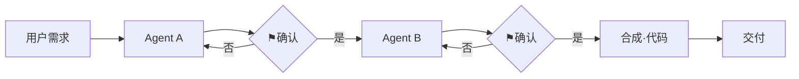
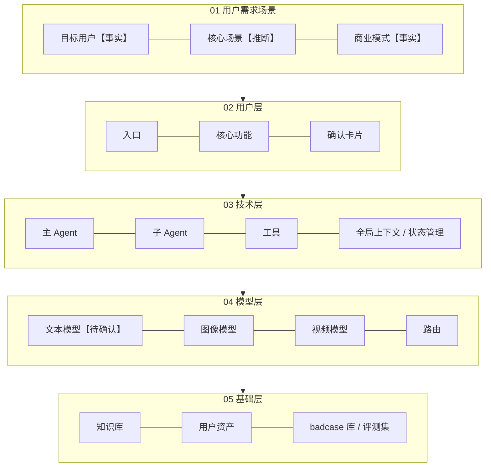

# 输出模板

> 用法：§1 是拆解文档的整体骨架，§2 是各层可直接复制的表格。按 Step 0 定好的深度删减，不需要的层或小节直接删掉，不要硬填。
> 每个单元格或每条结论都标【事实】【推断】【待确认】中的一个。

---

## §1 拆解文档骨架

```markdown
# 拆解《产品名》：<一句话结论，例如"把一整个动画团队装进一个输入框">
- 拆解目的 / 深度：<日常练习 | 竞品调研 | 0→1 | 1→N（只拆 X 层）| 效果迭代>
- 取证范围：<官网、价格页、亲测 N 次（截图 #1–#N）、视频、访谈……>；取证日期：YYYY-MM-DD
- 证据标签：【事实】页面直接可见 ·【推断】有依据的推论 ·【待确认】查不到

## 01 用户需求场景
### 1.1 一句话定位　### 1.2 用户（B 端三个人 / C 端画像）
### 1.3 市场　### 1.4 竞争格局　### 1.5 差异化　### 1.6 商业模式　### 1.7 种子用户

## 02 用户层
### 2.1 功能模块　### 2.2 用户旅程图（正向五步 × 四行）　### 2.3 异常四条
### 2.4 正向 / 逆向流程　### 2.5 它替代了以前什么工作流　### 2.6 亲手测评与打分

## 03 技术层
### 3.1 技术流程图　### 3.2 人机分工表　### 3.3 确认点设计　### 3.4 光谱定位与依据
### 3.5 Agent 组成　### 3.6 单个 Agent 拆解（核心 1–2 个）
### 3.7 全局上下文 / 状态管理 / 违规与 IP 防护　### 3.8 它没做好的地方

## 04 模型层
### 4.1 模型清单　### 4.2 路由逻辑　### 4.3 强模型 vs 聪明流程　### 4.4 成本估算　### 4.5 省钱手段

## 05 基础层
### 5.1 买得到 vs 买不到　### 5.2 数据内容与来源　### 5.3 数据飞轮　### 5.4 最厚的一层

## 汇总
### 分层架构图　### PM 结论（三件事 / 五个差距 / 如果我来做）　### （可选）竞品逐层对比

## 待核实清单
```

---

## §2 各层表格模板

### 01 用户需求场景

**一句话定位**：一款给【】用的、在【】下、解决【】的【】。【推断】依据：官网标语「」+ 价格页收费对象 ___

| B 端三个人 | 是谁 | 为什么用 / 看什么指标 | 证据 |
|---|---|---|---|
| 用的人 | | | |
| 买单的人 | | | |
| 验收的人 | | | |

| 竞争格局 | 代表玩家 | 定位 / 用户为什么买单 | 和本产品的关系 |
|---|---|---|---|
| 工具 / 应用层 | | | 直接 / 间接竞品 |
| 平台层（渠道、分发） | | | 上下游 / 潜在竞争 |
| 模型厂商 | | | 供应商 / 潜在竞争 |

| 商业模式 | 内容 | 证据 |
|---|---|---|
| 收谁的钱 | | |
| 收费方式和档位 | 免费 / 档位 1 / 档位 2 / 企业版 | |
| 免费额度、付费点 | | |
| 种子用户来源 | | |

### 02 用户层

**用户旅程图**（⚑ 表示确认点）

| | ①入口 | ②输入 | ③过程 | ④输出 | ⑤交付 |
|---|---|---|---|---|---|
| 用户做什么 | | | | | |
| 产品给什么 | | | | | |
| 确认点 ⚑ | | | | | |
| 异常 / 卡点 | | | | | |

| 异常四条 | 我怎么测的 | 它怎么处理 | 评价 | 证据 |
|---|---|---|---|---|
| 信息给不全：会追问吗 | | | | |
| 失败：告诉你吗，钱退吗 | | | | |
| 中途改主意：要从头来吗 | | | | |
| 不满意：能只改一部分吗 | | | | |

**替代的工作流**：以前 ___（角色）用 ___（工具）花 ___（时间 / 钱）→ 现在用户只做 ___。


### 02 用户层 · 效果体验·权重与评级（强制）

> 权重结构【示例】来自 OiiOii 拆解（飞书 07）：端到端 40%／交互共创 20%／Agent 协作 25%／基础能力 15%。可改比例，但**不可空着**。

| 评估维度 | 权重% | 核心考察点 | 满分 | 得分 | 评级 |
|---|---:|---|---:|---:|---|
| 端到端效果 | 40 | | | | |
| 交互共创层 | 20 | | | | |
| Agent 协作层 | 25 | | | | |
| 基础能力层 | 15 | | | | |
| **合计** | 100 | | | | |

**分数评级四档**（项目可改阈值，须写明）：

| 档 | 分数区间（示例） | 含义 |
|---|---|---|
| A | ≥85 | 可演示／可深用 |
| B | 70–84 | 主路径可用，短板明确 |
| C | 55–69 | 仅部分场景 |
| D | &lt;55 | 不建议作为标杆 |

### 01 市场层空表（强制检查）

| 层 | 代表玩家 | 定位 | 与本产品关系 |
|---|---|---|---|
| 工具／应用 | | | |
| 平台／渠道 | | | |
| 模型 | | | |

### 04 模型层路由表（强制检查）

| 类别（生图/视频/文本…） | 模型名称 | 优势 | 适用场景 | 证据 |
|---|---|---|---|---|
| | | | | |

### 商业层（可变现提问）

| 项 | 内容 | 证据 |
|---|---|---|
| 收谁的钱 | | |
| 护城河（买不到的） | | |
| 仍待确认的变现点 | | 【待确认】 |

**亲手测评**
- 测试场景：<一句话 + 输入原文>；测试轮次：模糊 / 具体 / 异常
- 维度权重和分值要一致（权重 = 该维度满分，合计 100）：

| 能力层级 | 评测维度 | 考察点 | 打分逻辑 | 满分 | 得分 |
|---|---|---|---|---|---|
| 端到端 | 成品质量 | 可用性、完整度、有趣度 | 能不能直接交付 / 消费 | 20 | |
| 端到端 | 一致性 / 稳定性 | 跨步骤、跨轮次是否稳定 | 闪烁、错乱、风格跳变 | 20 | |
| 用户层 | 意图理解与引导 | 大白话 → 专业产出；没灵感时会不会主动建议 | | 15 | |
| 用户层 | 反馈与灵活性 | 局部修改、回退后能不能回到主流程 | | 10 | |
| 技术层 | Agent 协作 / 流程 | 信息传递准确性、纠偏能力 | 改上游后下游是否同步 | 15 | |
| 技术层 | 领域知识运用 | 是否靠逻辑控制而非纯抽卡 | | 10 | |
| 模型与数据 | 模型调度 | 是否按场景选对模型 | | 5 | |
| 模型与数据 | 资产复用与沉淀 | 资产能否跨项目复用 | | 5 | |
| | | | **合计** | **100** | |

评级：90–100 稳定产出高质量结果 ｜ 70–89 流程通顺，少量人工干预后效果不错 ｜ 60–69 有明显断档，但适合做创意启发和草稿 ｜ <60 无法完整交付。
（不同品类请替换维度，但保持"端到端 + 过程各层"的结构。）

### 03 技术层

**技术流程图**（mermaid 示例）


**人机分工表**

| 步骤 | AI 做 | 人做 | 确认点（类型） | 为什么要人（成本高 / 主观 / 担责） | 证据 |
|---|---|---|---|---|---|
| | | | 动手前审方案 / 风险前停 / 事先给额度 / 用户调档 / 无 | 错了能在产品里改回来吗？ | |

**光谱定位**：Chatbot / Workflow / Agent / 多 Agent → 选 ___。依据：有没有计划 ___；有没有进度 ___；有没有子任务 ___；在哪停下来问你 ___；换任务后步骤变不变 ___。

**Agent 组成**

| Agent | 对应人类岗位 | 职责 | 读 / 写哪些上下文字段 | 人在哪介入（HITL） | 证据 |
|---|---|---|---|---|---|

结构：串行 / 并行 / 主子 Agent？依据：___

**单个 Agent 卡片**

| 项 | 内容 |
|---|---|
| 输入 | 收什么（用户输入、上游字段、表单回填） |
| 输出 | 交什么（字段、资产、动作、给下游的信号） |
| 任务 | 干哪件活，分几步，有哪些分支（明确 / 不明确 / 风险） |
| 工具 | 能调什么（生成类、检索类、表单 / 追问类、上下文 / 状态类、调度类） |
| 规则 | 守什么规矩（边界、禁止项、合规、格式） |
| 架构 | ReAct / Planner-Executor，理由 |

**它没做好的地方**

| 现象（截图 #） | 可能原因 | 解决方案（提示词 / 工具 / 状态机） | 证据 |
|---|---|---|---|

### 04 模型层

**模型清单**

| AI 步骤 | 模态 | 模型 / 档位 | 自研 / 外接 | 能否替换（换了会怎样） | 选择理由 | 证据 |
|---|---|---|---|---|---|---|

**路由逻辑**：自动路由 / 按风格或场景匹配 / 用户选 → ___；必须用强模型的环节：___；靠流程聪明就够的环节：___

**成本估算**（单任务，例如"一条 30 秒成片"）

| 步骤 | 模型 / 资源 | 调用次数 | 单价 | 小计 | 证据 |
|---|---|---|---|---|---|
| 文本规划 | LLM | n₁ | p₁ | n₁×p₁ | 【待确认】 |
| 图像生成 | 生图模型 | n₂ | p₂ | | |
| 视频生成 | 生视频模型（按秒） | 秒数 | p₃/秒 | | |
| 音频 | TTS / BGM | | | | |
| 其他 | 机器 / 沙箱 / 第三方接口 | | | | |
| **合计** | ×重试（抽卡）系数 k | | | **C = Σ × k** | 【推断】 |

| 收入侧 | 数值 | 证据 |
|---|---|---|
| 单任务扣多少积分 | | 扣费提示 / 积分规则 |
| 积分单价 = 档位价格 ÷ 档位积分 | | 价格页 |
| 单任务收入 R | | |
| 毛利 = R − C；免费用户每天亏损 = 免费额度 × C | | 【推断】 |

查不到单价时：只写公式和假设区间，明确标【待确认】，不要给出看似精确的数字。

### 05 基础层

| 买得到（划掉） | 买不到（壁垒候选） | 越用越多吗 | 证据 |
|---|---|---|---|
| 模型 / 算力 / 通用工具 / 开源代码 | 自有数据 · 业务接口和权限 · 用户和组织上下文 · 攒下的方法（提示词 / skill / 工作流 / 知识库） | | |

| 数据 | 内容 | 来源 | 怎么用（训练 / 调提示词 / 案例） | 证据 |
|---|---|---|---|---|

**数据飞轮**：___（资产 / 会话 / 风格库 / skill）→ badcase 库 → 评测集 → 调 ___ → 效果 ↑ → 用户 ↑
**最厚的一层**：___ 层，因为 ___ → 这家公司要的 PM 需要懂 ___

### 汇总：分层架构图（框里写名词，每框带标签）



### 汇总：PM 结论

| 项 | 结论 |
|---|---|
| 体验设计 | |
| 能力边界（它不做什么） | |
| 信任设计（透出过程、确认点、退款） | |

| Demo → 完整产品的五个差距 | 它怎么补的 | 证据 |
|---|---|---|
| 给谁用 | | |
| 出了错怎么办 | | |
| 稳不稳 | | |
| 账算不算得过来 | | |
| 凭什么选你 | | |

**如果我来做**：改 ___ → 因为 ___ → 用 ___ 指标或实验验证。

### （可选）竞品逐层对比

| 层 | 本产品 | 竞品 A | 竞品 B | 差异的根源（回到定位） |
|---|---|---|---|---|
| 01 定位 | | | | |
| 02 交互形态 | 对话 / 画布 / 模板 | | | |
| 03 架构 | | | | |
| 04 模型与收费 | | | | |
| 05 壁垒 | | | | |

### 待核实清单

| # | 待确认事项 | 当前猜测 | 怎么核实 |
|---|---|---|---|
